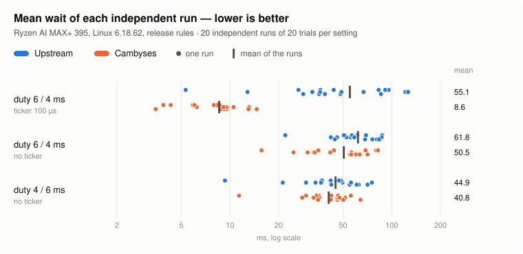
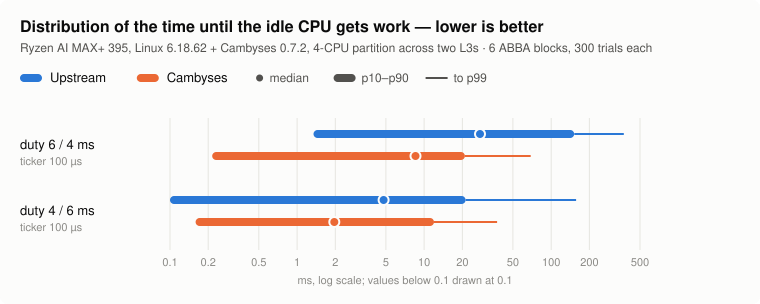
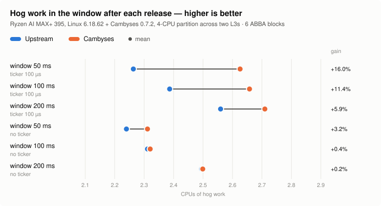

# Cambyses

Two small changes to the CFS load balancer's `detach_tasks()`, the function
that decides which tasks to pull off a busy runqueue. About 70 lines of code
(240 with the comments that explain them), no new struct fields, no hot-path
hooks, no tunables. Both are behind `sched_feat()`, so they can be compared
with upstream at runtime without a reboot.

## At a glance

- **`LB_CONCEDE_CHEAPEST`** helps when one LLC is overloaded and a CPU in another
  LLC sits idle. Upstream often refuses to hand that CPU a task that is "too
  big" for its spare capacity and leaves it idle for tens of milliseconds;
  Cambyses hands it over as soon as doing so still reduces the imbalance.
  - When a light thread wakes often on the idle CPU (as a thread handling
    frequent I/O completions or a timer-driven loop would), the idle CPU gets
    work **about six times sooner** (8.6 ms instead of 55.1 ms on average), its
    worst waits (p99) shrink **four- to fivefold**, and the waiting tasks get
    **up to 16% more work done** in the 50 ms after the imbalance appears.
    Better in 19 of 20 independent runs, or 6 of 6 blocks.
  - Without such a thread the idle CPU balances less often; the wait is still
    about 18% shorter when the idle CPU is busy 60% of the time, and the same
    when it is busy 40%.
- **`LB_ROTATE_BLOCK`** does the same scan with fewer list operations. No
  measurable effect on real hardware, as expected for a saving of this size.
- **No regression was found** in any workload measured, including the ones
  designed to expose one.

These are best cases built on purpose: they show how large the effect is when
the situation arises, not how often it arises. Details, scale and significance
are in [Where it helps](#where-it-helps-an-idle-cpu-waiting-for-work-across-llcs)
and [Where it does nothing](#where-it-does-nothing).



*Each dot is one run of 20 trials: how long, on average, an idle CPU in the
other LLC waited for work. "duty 6 / 4" means the task on that CPU runs 6 ms and
sleeps 4 ms; the "ticker" is the light thread that wakes every 100 µs.*

---

## 1. `LB_ROTATE_BLOCK` — advance the scan window as a block

`detach_tasks()` walks `cfs_tasks` from the tail and moves every task that
fails `can_migrate_task()` to the head of the list, one at a time. That does
two jobs at once: it steps past the reject, and it leaves the list rotated so
the next balance pass starts on tasks this one did not reach.

Only the second job needs the list touched at all. Doing it per reject costs
one list operation per rejected task with the rq lock held, and because only
rejects are promoted, the resulting order is a function of migration outcome.

Walk with a cursor instead and rotate the examined block to the head once, at
the end of the scan. Coverage is unchanged — a later pass still resumes where
this one stopped — but the cost drops to one list operation per scan.

A userspace model of the loop (same list primitives, same structure, under
ASan/UBSan) shows identical coverage across runqueue sizes and scan budgets,
with list operations down 64% in a steady-state mix and 85% when few tasks are
movable. It does not reproduce any difference in where rejects end up sitting
in the list, so this is a cost reduction rather than an ordering fix.

**Real hardware: no measurable effect either way, no regression.** Expected for
a cost reduction of this size.

## 2. `LB_CONCEDE_CHEAPEST` — size candidates against the budget, not a failure count

A migration candidate whose cost exceeds the remaining imbalance is rejected.
Upstream relaxes that comparison by `sd->nr_balance_failed`, halving the
candidate's apparent cost once per recorded balance failure, so an oversized
task is eventually let through.

**That counter is reset on any successful migration at the domain**, and
newidle balance does not count its failures at all. A steady supply of
cheap-to-move tasks therefore keeps resetting it, and an idle CPU that balances
mostly through newidle may wait a long time before the relaxation lets anything
through. The relaxation is per-domain and history-dependent, but the question
it answers ("is this task too big for the budget?") is per-task and local to
the scan.

Removing the relaxation on its own is not safe: it is also the only route by
which an over-budget task ever moves under `migrate_load`/`migrate_util`,
because `imbalanced_active_balance()` escalates for `migrate_task` only.
Modelling that showed the source left 34–98% skewed. So the implicit guarantee
is replaced with an explicit one:

> **A scan that admits nothing concedes to the smallest overshoot it saw.**

Progress is then guaranteed by the candidates actually present rather than by a
counter other tasks keep clearing, and it acts on the first scan that admits
nothing instead of once enough failures have been recorded.

### When it concedes

The concession is narrow by design. It applies only when all of these hold:

- **The balance pulls into an idle CPU** (`env->idle != __CPU_NOT_IDLE`:
  newidle or periodic idle balance). Handing an idle CPU work is worth an
  overshoot. A busy destination gains nothing from one and can flip the
  imbalance and bounce the task back, so it keeps the upstream
  `nr_balance_failed` relaxation. The test uses `env->idle`, which is fixed for
  the whole balance, not `idle_cpu(dst)`, which a wakeup can change between
  candidates.
- **The balance was not redirected.** When none of the busiest runqueue's tasks
  may run on the idle CPU that asked for them, `sched_balance_rq()` sets
  `LBF_DST_PINNED` and retries towards another CPU of the same group.
  `env->idle` still describes the CPU that asked, but the new destination is
  normally busy. The retry is marked (`LBF_DST_REDIRECTED`) and does not
  concede.
- **The overshoot still shrinks the imbalance.** Moving cost *c* against an
  imbalance *I* leaves |*I* − *c*|, which is smaller than *I* only while
  *c* < 2*I*. A larger move flips the imbalance and lets the reverse balance
  pull a task straight back; under this bound the same task can never bounce,
  since pulling it back would need *c* > 2*I*. This matters most for newidle
  balance, which runs every time a CPU goes idle.

It fires at most once per balance operation, and only after a scan admitted
nothing.

### Where it helps: an idle CPU waiting for work across LLCs

**The test** (`benchmark/fill.c`) reduces the case to four CPUs, two in each of
two LLCs:

- LLC A: two CPUs shared by three CPU-bound tasks ("hogs"), so it is
  overloaded.
- LLC B: one CPU runs another hog; the other runs a *duty task* that is busy
  for a few milliseconds and then sleeps for a few, so that CPU keeps going idle.
  "Duty 6 / 4" means 6 ms busy, 4 ms asleep.

Each trial pins the three hogs to LLC A for 300 ms and then *releases* them to
all four CPUs. The latency test measures how long the idle CPU in LLC B waits
until one of them arrives (the hogs timestamp their own arrival). The
throughput test repeats the release and counts the work the hogs get done in a
fixed window after it.

**Why upstream is slow here.** Between LLCs the balancer measures the imbalance
as the idle side's spare capacity, and the duty task's utilization still counts
against that spare while it sleeps. A time-shared hog (three hogs on two CPUs,
util ≈ 680) then costs more than the spare it would fill, so upstream refuses it
until enough periodic balances have failed to relax the comparison. Cambyses
moves it on the first scan in which the overshoot still shrinks the imbalance.

**The ticker.** How much sooner depends on how often the idle CPU balances. A
CPU runs a newidle balance every time it goes idle, so the test is run with and
without a *ticker*: a light thread on the idle CPU that wakes every 100 µs and
sleeps again. Any thread that is woken often on that CPU does the same — for
example one handling a stream of short network or storage completions, or a
timer-driven loop such as audio processing — though those were not measured
here. Without the ticker, the idle CPU balances only when the duty task goes to
sleep and on the periodic idle balance.

**Data.** Ryzen AI MAX+ 395 (32 threads, two L3), Linux 6.18.62, a cpuset root
partition of CPUs 0, 1 (L3 #0) and 8, 9 (L3 #1), `governor=powersave`. Two data
sets:

- *Runs*: 20 independent runs per setting, 20 trials each, alternating
  upstream and Cambyses, on a build that exposes the release rules as a runtime
  switch. Independent runs matter here: without the ticker, one run's mean
  wait varies from one process start to the next (9–75 ms at duty 4 / 6), more
  than a few blocks can average out. Raw:
  `benchmark/results/strix-6.18.62-runs.txt`.
- *Blocks*: the 0.7.2 release kernel. Six blocks; in each block every condition
  runs once with the feature off and once on, in ABBA order across blocks. Per
  block and condition 50 trials (latency) or 30 cycles (throughput), after 5
  discarded warm-up trials: 300 trials or 180 cycles per setting. Raw:
  `benchmark/results/strix-6.18.62-cambyses072.txt`.

**Significance** is an exact two-sided sign test over the paired runs or blocks
(Cambyses against upstream in each pair). With six blocks the smallest possible
p is 0.031 (6/6). No trial hit the 1 s limit.

#### Time until the idle CPU gets work — lower is better

Mean wait in ms, from the larger data set available for each setting. The
figure at the top of this README shows the runs one by one.

| duty task (busy / asleep, ms) | ticker | data | upstream (ms ↓) | Cambyses (ms ↓) | Cambyses better in, sign p |
|---|---|---|---|---|---|
| 6 / 4 | 100 µs | 20 runs | 55.1 | **8.6** | 19/20 runs, p < 0.001 |
| 4 / 6 | 100 µs | 6 blocks | 10.6 | **5.7** | 6/6 blocks, p = 0.031 |
| 6 / 4 | none | 20 runs | 61.8 | **50.5** | 15/20 runs, p = 0.041 |
| 4 / 6 | none | 20 runs | 44.9 | 40.8 | 12/20 runs, p = 0.50 |

With the ticker the long waits shrink most. Distribution over the 300 trials
of the blocks, ms (p10 / p50 / p90 / p99):

| duty task (busy / asleep, ms) | ticker | upstream (ms ↓) | Cambyses (ms ↓) |
|---|---|---|---|
| 6 / 4 | 100 µs | 1.4 / 27.5 / 151.9 / 372.9 | **0.2 / 8.6 / 20.9 / 68.9** |
| 4 / 6 | 100 µs | 0.01 / 4.8 / 21.2 / 156.9 | **0.2 / 2.0 / 11.9 / 37.5** |



---

#### Hog work in the window after each release — higher is better

Duty task 6 / 4, blocks data. Work in ms of a hog running alone on a CPU, mean
of 180 cycles. The figure divides it by the window, giving CPUs' worth of hog
work, so that windows of different length share one axis.

| window | ticker | upstream (work ↑) | Cambyses (work ↑) | gain | Cambyses better in, sign p |
|---|---|---|---|---|---|
| 50 ms | 100 µs | 113.2 | 131.3 | **+16.0%** | 6/6 blocks, p = 0.031 (block ratio 1.04–1.24) |
| 100 ms | 100 µs | 238.7 | 265.8 | **+11.4%** | 6/6 blocks, p = 0.031 (1.01–1.19) |
| 200 ms | 100 µs | 511.9 | 542.0 | **+5.9%** | 6/6 blocks, p = 0.031 (1.03–1.11) |
| 50 ms | none | 112.0 | 115.6 | +3.2% | 4/6 blocks, p = 0.69 |
| 100 ms | none | 231.1 | 232.1 | +0.4% | 2/6 blocks, p = 0.69 |
| 200 ms | none | 499.0 | 499.8 | +0.2% | 4/6 blocks, p = 0.69 |



**Reading the results.** With the ticker, the idle CPU gets work about six
times sooner at duty 6 / 4 and twice as soon at 4 / 6, and its p99 wait drops
four- to fivefold. The hogs get 18–30 ms more work done per release, which is
16% of a 50 ms window and 6% of a 200 ms one. Counted over the whole cycle,
including the 300 ms in which the hogs are pinned (the same under both
kernels), the 50 ms case is +2.5%.

Without the ticker the wait at 6 / 4 is about 18% shorter, only just
significant, and at 4 / 6 there is no difference. Work without the ticker was
measured only in the blocks, which cannot resolve a difference of this size, so
for it we claim nothing.

### Where it does nothing

Same machine, same boot, upstream vs Cambyses by `sched_feat`, order-rotated.
These are the workloads in which a change could show up as a regression; in
all of them the concession did (almost) nothing, and no difference was found:

| workload | settings | rounds per setting | concessions | result |
|---|---|---|---|---|
| `schbench` probe + `stress-ng` hogs in a cpuset that leaves part of an LLC unusable (CPUs 0–7 or 0–3) | 6 (fan-out, probe threads, hog mix) | 6–8 | 0 | no difference in probe RPS or hog throughput |
| `mixbench` heavy + light threads, 400 µs sleeps | 16+16, 24+24, 32+32 | 6, 6, 18 | 0 (counted at 32+32) | no difference in either class |
| `mixbench` 24 + 24, no sleeps | 1 | 50 (four sessions) | 0 (counted in 32 of the 50 rounds) | no difference: heavy −0.7% (CI −1.4 to +0.7), light +1.0% (CI −0.3 to +1.8) |
| `stress-ng` hogs + `schbench` probe, 48 hogs on 32 CPUs, 24 on one 16-CPU L3 | 2 | 4 | 1–3 per run | no difference |

**How "no difference" was judged.** For each setting and metric, the median of
the per-round change with a bootstrap 95% confidence interval. Most settings had
only 6 rounds, so single estimates scatter widely: from −4.9% to +4.3%, with
intervals that include zero. Of the 22 metric comparisons one interval misses
zero (`mixbench` 32+32 heavy class, −0.6%, CI −1.3 to −0.2), about what chance
alone gives across 22 comparisons (the 4-round `stress-ng` runs are not among
them). Running upstream against itself (A/A, `mixbench` 24+24) scatters the same
way: −0.5%, CI −2.2 to +1.8. All 22 comparisons and the raw logs are in
`benchmark/results/no-regression/`.

**Why.** Apart from conceding, Cambyses can differ from upstream only by
refusing, for an idle destination, an over-budget task that upstream's
`nr_balance_failed` relaxation would have let through. In a 20-round session of
the `mixbench` no-sleep run that was counted too, with a build that applies the
relaxation on top: it let nothing through. So there the two kernels made the
same balancing decisions. The concession is rare by construction: it acts only
when an idle CPU's balance found nothing that fits.

The redirect rule above was found with the first workload of the table:
without it, every concession there went to a busy CPU, and the `schbench`
probe lost up to 8.5% RPS with wakeup p99 up to 49% worse. With it, those
cases make no concessions.

---

## Usage

Apply the patch for your kernel from `patches/` to a clean tree:
`0001-6.12.74-cambyses-v0.7.2.patch`, `0001-6.18.62-cambyses-v0.7.2.patch` or
`0001-7.3.0-rc5-cambyses-v0.7.2.patch`. Both features default on:

```sh
echo NO_LB_ROTATE_BLOCK     > /sys/kernel/debug/sched/features
echo NO_LB_CONCEDE_CHEAPEST > /sys/kernel/debug/sched/features
```

Requires `CONFIG_SCHED_DEBUG=y` and `CONFIG_JUMP_LABEL=y` for the runtime
toggle; otherwise the features compile to constants.

### Reproducing the idle-fill case

`benchmark/` holds the idle-fill test above. It needs a machine with at least
two LLCs, root, cgroup v2 with the cpuset controller, and the runtime toggle:

```sh
make -C benchmark
sudo benchmark/fillab.sh fillab.log 6        # log, blocks
benchmark/fillsum.py fillab.log              # tables and per-block ratios
benchmark/mkfig.py fillab.log lat.svg lat    # the figures above (lat, tput, runs)
```

`fillab.sh` picks two cores from each of the first two LLCs (override with
`CPUS="A0 A1 B0 B1"`), puts them in a cpuset root partition so that the balancer
sees exactly two LLC groups, and alternates the feature in ABBA order. Six
blocks of the default set take about 40 minutes. `TESTS`, `DUTIES`, `TICKS`,
`FREES`, `TRIALS` and `CYCLES` select a subset; see the script header. Without
the ticker, use many blocks with few trials each (for example 20 blocks of 20
trials) rather than a few long ones. Which duty cycles show the effect depends
on the CPU's speed and on PELT.

Earlier harnesses (`lbmix2.sh`, `mixbench.c`, `lbsig.py` and others) are in
this repository's history up to the 0.7.1 commit.

## What was tried and dropped

**A scored candidate pipeline.** The project started as a replacement for
`detach_tasks()`'s task selection: score every candidate (staleness and weight
in log space, packed into 16 bits), keep shadow copies of scheduler state in
`struct rq` and a side array of task pointers, and pick with a SIMD argmax and
a prefetch pipeline. Benchmarks run on volunteers' hardware showed no
meaningful difference, and that design was abandoned. What is here is the part
that survived: two local changes to the existing loop. The pipeline is in this
repository's history before the 0.6.0 commit.

**Rules the concession no longer has**, each measured and found wrong:

- *Conceding to busy destinations too.* With `stress-ng` hogs and a
  `schbench` probe on the two-L3 machine, 99.6–100% of the concessions went to
  busy CPUs, and the probe got slower in a short (4-round) check. Hence the
  idle-only rule.
- *Conceding without the 2× bound.* An overshoot larger than the imbalance
  flips it and invites the reverse balance to pull a task back, and newidle
  balance runs often enough to keep that going. Hence *c* < 2*I*.
- *Conceding after a redirect.* See the cpuset results above. Hence the
  redirect rule.
- *Falling back to upstream's relaxation for idle destinations* when no
  candidate is under 2*I*, so that Cambyses would never refuse a task upstream
  accepts. It let a task through a few dozen times per 20 runs of the idle-fill
  test and never in `mixbench`, with no measurable difference either way, so it
  was not added.

## Scope

The `LB_CONCEDE_CHEAPEST` results above were measured on one machine: Ryzen AI
MAX+ 395, 16C/32T, two L3 domains, one NUMA node, `governor=powersave`,
synthetic workloads. `LB_ROTATE_BLOCK` was checked on a Ryzen 7 7840HS (8C/16T,
one L3, `governor=performance`). NUMA topologies — where migration is far more
expensive — are untested, as are real workloads such as a kernel build.

Neither patch references BORE or POC Selector; both operate on stock CFS.

On Linux 7.3 the balancer also has cache-aware scheduling (`LBF_LLC_PINNED`),
which does not count an LLC-locality refusal in `nr_balance_failed`. For a busy
destination, where this patch keeps the upstream relaxation, that relaxation
therefore advances more slowly there than on 6.12. The LLC check runs before
the budget test, so a task it refuses is never a concession candidate.

## License

GPL-2.0
